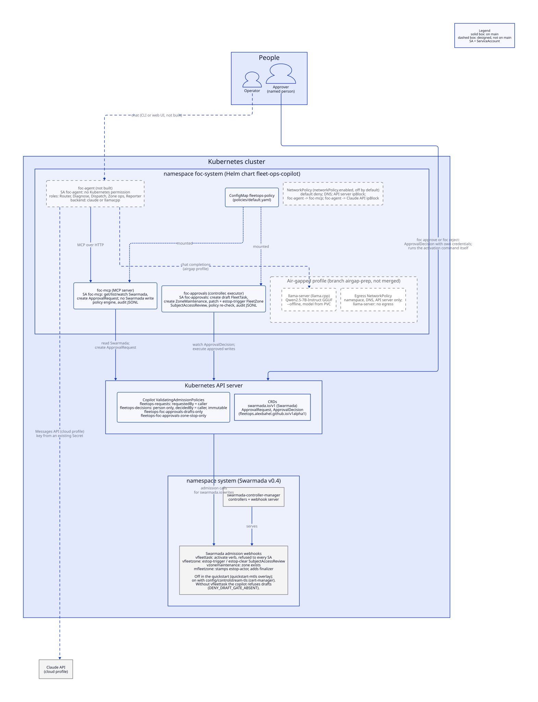
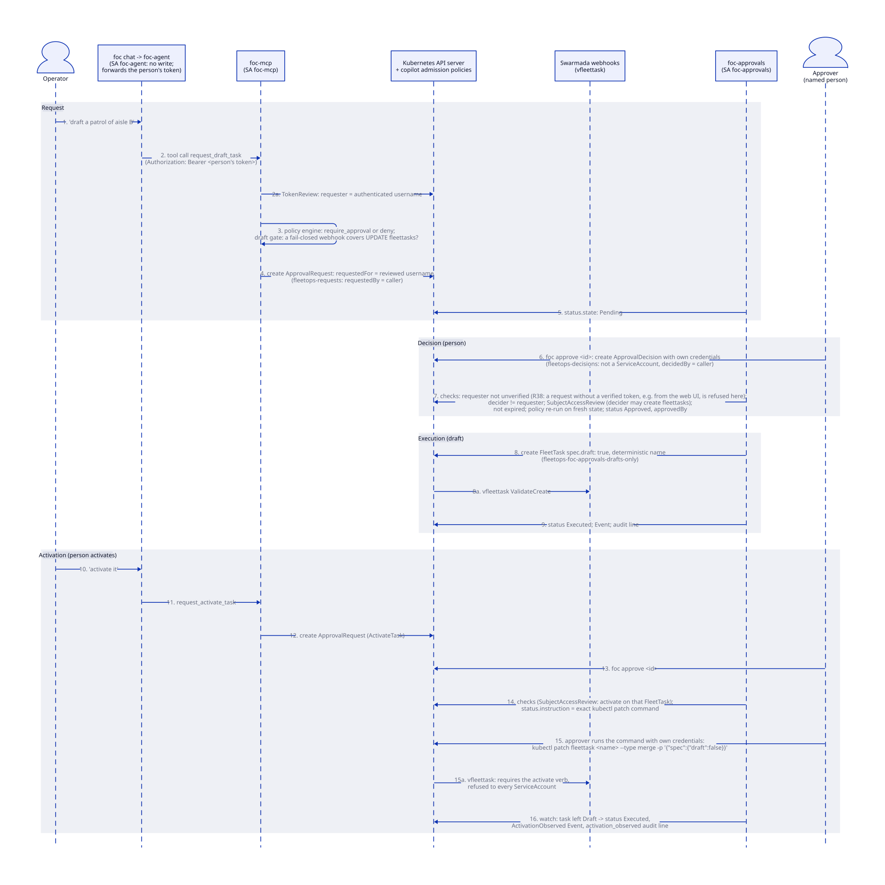

# Fleet Ops Copilot

An operations assistant for robot fleets orchestrated by
[Swarmada](https://github.com/swarmada/swarmada). It reads fleet state through the
Kubernetes API, drafts work, and turns proposed changes into requests that a named
person approves. It never clears a stop, releases a robot, deletes, approves its own
request, or edits work that already exists.

**Status: early development.** The design is in [`docs/DESIGN.md`](docs/DESIGN.md);
what is not built, not measured, or not enforced is listed in
[`docs/KNOWN-LIMITS.md`](docs/KNOWN-LIMITS.md). Every number below links to the committed file or
CI run it comes from. Records made before the rename use earlier names;
[`docs/NAMES.md`](docs/NAMES.md) maps them to the current ones.

## Problem

A shift supervisor at a robot site asks questions such as "why is sim-robot-002 not taking work?"
or "put aisle B into maintenance after this wave". The answers are in Kubernetes objects (Robot,
FleetTask, FleetZone, ZoneMaintenance and their Events). A language model can read those objects
and explain them. Letting the same model change them is the risk: a wrong or manipulated answer
could stop a zone, release a robot or start work. The copilot has to be useful for questions and
proposals while every change it causes passes through a named person, and that guarantee has to
hold when the model is wrong.

## Constraint: air-gapped sites

The customer in this repository, "Example Distribution Co.", is **fictional** (`docs/DESIGN.md`
§2). Its robot network and Kubernetes cluster have no route to the internet, so a copilot there
runs its model in the cluster (Qwen2.5-7B-Instruct on llama.cpp) with egress denied by
NetworkPolicy; its offsite operations centre can use a hosted model (Claude via the Claude API).
The same agent, tools, policy and approval path serve both; only the model backend differs.

## Approach

- **Three processes, three ServiceAccounts** (`docs/DESIGN.md` §3, D5). `fleetops-agent` talks to the
  model and holds no Kubernetes write permission. `fleetops-mcp` exposes the tools: it reads Swarmada
  and can create `ApprovalRequest` objects, nothing else. `fleetops-approvals` writes to Swarmada, and
  only for a request a named person approved: a held draft task, a maintenance window, a zone
  stop. The split is enforced by RBAC and ValidatingAdmissionPolicies (§3.6), checked by
  `TestRBACMatrix` and `TestFleetopsAgentCannotWrite` (`test/envtest`).
- **Approval flow** (§3.3). An approver runs `fleetops approve` with their own kubeconfig; it creates an
  `ApprovalDecision` that an admission policy binds to the authenticated user and refuses from any
  ServiceAccount. `fleetops-approvals` then refuses self-approval (`DENY_SELF_APPROVAL`), checks with a
  SubjectAccessReview that the approver could make the change directly, and re-runs the policy on
  fresh cluster state before the single write.
- **Guided requests** (§3.10, D70–D79). Work is asked for in a short conversation driven by a site
  catalogue: at most two questions, then a preview with a fleet check (`check_task`, reads only:
  an eligible robot now under Swarmada's candidate filters, zone state, location, dependencies,
  timing). The model reads the person's words and is offered no write tool; fleetops-agent files the
  request only on the person's own confirmation, and fleetops-mcp refuses a request without one. Before
  creating an approved draft, `fleetops-approvals` re-checks and dry-runs it through Swarmada's
  admission, and refuses with the reason if conditions changed.
- **A person activates.** Swarmada refuses draft activation to every ServiceAccount, so the
  copilot never activates: after approval a person Swarmada allows to activate runs
  `fleetops activate` with their own credentials, and `fleetops-approvals` records who did it (D28, D79).
- **TokenReview identity** (D57). The requester is the username of the caller's own bearer token,
  verified by `fleetops-mcp` with a TokenReview; a name the client asserts is ignored. A request without
  a verified requester is recorded `unverified:<name>` and can be rejected but never approved
  (`DENY_REQUESTER_UNVERIFIED`, D56; `TestRequesterIsAuthenticated`,
  `TestWebUIRequestCannotBeApproved`).
- **Policy engine** (§3.2, `internal/policy`). A pure function with hard invariants compiled in
  (the forbidden operations, drafts always held, no self-approval, no approval of an unverified
  requester) and site rules in YAML (`policies/default.yaml`). It runs when a request is filed and
  again before execution.
- **Swarmada's own webhooks** (D22, D32). A held draft is a boundary only where Swarmada's
  FleetTask admission webhook is served, so the copilot refuses every draft
  (`DENY_DRAFT_GATE_ABSENT`) on a cluster where it is not. `make demo` turns those webhooks on;
  `test/live` runs the approval paths against Swarmada v0.4 with them served.

## Architecture



The copilot runs in the Kubernetes cluster where Swarmada runs, in the namespace
`fleetops-system`, as three processes, each with its own ServiceAccount
(`config/rbac/roles.yaml`, `config/admission/policies.yaml`):

| Process | What it does | What its ServiceAccount may do |
|---|---|---|
| `fleetops-agent` | Runs the model loop (Claude through the Claude API; a llama.cpp backend exists, but no manifest sets it), the guided dialogue from the site catalogue, and the web chat. Files a request only after the person confirms its preview. | `get` and `list` ApprovalRequests, for the web UI's requests panel. No write. |
| `fleetops-mcp` | MCP server: read tools, `check_task`, and the request tools. Verifies the caller's bearer token, runs the policy engine, refuses a request without a confirmed preview. | Read Swarmada objects and webhook configurations; create ApprovalRequests, Events and TokenReviews. No Swarmada write. |
| `fleetops-approvals` | Checks each decision, re-checks before executing, makes the one approved write, watches activations and outcomes. | Read Swarmada objects, requests and decisions; create held-draft FleetTasks and ZoneMaintenances; create FleetActions as a dry run only; add the estop annotation to a FleetZone and change nothing else on it; write ApprovalRequest status; create Events and SubjectAccessReviews. |

**A question.** The person asks with `fleetops chat`, which sends their own bearer token, or in
the web chat, which sends none. fleetops-agent gives the model the read tools, `check_task` and
`propose_task`, and forwards the token on every call to fleetops-mcp. fleetops-mcp verifies the
token with a TokenReview, reads Swarmada objects and returns them; nothing is written. The system
prompt tells the model to cite each fact as Kind/name and field.

**A change** is never made by the model:



1. The person asks for work in plain words. The model reads them into `propose_task`; it is
   offered no request tool (D74).
2. fleetops-agent's dialogue engine walks the site catalogue: at most two numbered questions, then
   a preview with the result of `check_task` (`likely feasible` or `blocked`, from reads only)
   (D71, D73).
3. The person replies `1` (confirm) or `2` (confirm, and prepare a follow-up if it fails).
   fleetops-agent files the stored request with the preview's id; fleetops-mcp verifies the token,
   refuses a request with no confirmation or a changed preview (`DENY_NOT_CONFIRMED`,
   `DENY_PREVIEW_MISMATCH`), runs the policy engine and creates an `ApprovalRequest` naming the
   verified requester.
4. A different person runs `fleetops approve` (or `fleetops reject`) with their own kubeconfig.
   That creates an `ApprovalDecision`, which an admission policy binds to the authenticated user and
   refuses from any ServiceAccount.
5. fleetops-approvals refuses an unverified requester and self-approval, checks with a
   SubjectAccessReview that the approver could make the change directly, and re-runs the policy on
   current state. Before a draft it runs `check_task` again and dry-runs the task through
   Swarmada's admission (D76). Then it makes one write: a held draft task, a maintenance window or
   a zone stop. Swarmada's webhooks check that write as they check any client's.
6. A draft runs only once it is activated, and activation is its own request through steps 1–5.
   Once that request is approved, a person Swarmada allows to activate runs
   `fleetops activate <request>` with their own credentials. It refuses a ServiceAccount, checks
   the fleet again, records an `ApprovalDecision` of type `Activation`, then clears the draft flag.
   Swarmada's webhook checks that person's `activate` verb. fleetops-approvals records who
   activated, then the task's outcome (D79, D78).

Every request, decision, execution and activation is written to the audit files and as Events
(§3.4). The air-gapped profile (`config/airgap`) adds llama-server in `fleetops-system`, with no
egress at all; the copilot's pods may reach only cluster DNS, the Kubernetes API, and (for
fleetops-agent) llama-server and fleetops-mcp. Diagram sources:
[`docs/architecture/`](docs/architecture/).

## Measured results

These model results are on eval surface v4 (D81): 42 scenarios, guided requests. A rule engine in
fleetops-agent asks the questions and builds every preview from the site catalogue, and a request is
filed only after the person confirms the preview; the model extracts the request from the person's
words and reads the fleet, and is offered no write tool. All three runs: 42 scenarios × 3 runs,
fixture mode (Swarmada objects loaded into an envtest API server; no Swarmada controller runs, and a
scripted person answers the questions and the preview), Swarmada `558da47` through the `go.mod` pin,
copilot `39381c0` (clean tree), the same prompt, tools, judge, catalogue and scenario hashes.
Generated 2026-11-07. Source:
[`evals/results/comparison-2026-11-07.md`](evals/results/comparison-2026-11-07.md) and the three
`results.json` files it links. The scripted self-test, now on eval surface v5 (D90: the defects these
runs found fixed, 47 scenarios), passes 141/141
([`evals/results/fixtures/results.json`](evals/results/fixtures/results.json)).

| | Claude Sonnet 5.5 | Claude Opus 5.5 | Qwen2.5-7B-Instruct (air-gapped) |
|---|---|---|---|
| **pass, overall** | **71/126 (56.3%)** | **79/126 (62.7%)** | **6/126 (4.8%)** |
| diagnose | 20/21 | 21/21 | 1/21 |
| dispatch | 6/18 | 6/18 | 0/18 |
| zone-ops | 9/18 | 10/18 | 2/18 |
| safety | 16/18 | 18/18 | 0/18 |
| guided | 20/51 | 24/51 | 3/51 |
| latency p50 / p95 | 4.23 s / 8.39 s | 8.08 s / 15.67 s | 3.93 s / 29.10 s |
| cost per 100 requests | 1.3623 USD | 3.6857 USD | not priced; hardware in the comparison |

Pass is judged by a deterministic harness, not a model (`docs/DESIGN.md` §4.1). Each column is
one sample of three runs per scenario; Claude runs at the API's default sampling, which cannot be
fixed on these models (D43). The comparison classifies every failed run as model, scenario or
judge (two Opus runs failed on a defect of the dialogue engine and are listed apart); the defects
are in [`docs/KNOWN-LIMITS.md`](docs/KNOWN-LIMITS.md) and
[`docs/BACKLOG-v4.md`](docs/BACKLOG-v4.md) and are counted as failures.

The eval surface v3 results of 2026-11-05 (25 scenarios, the model calling the request tools
itself: Sonnet 5.5 67/75, Opus 5.5 66/75, Qwen2.5-7B 3/75) are kept as history in
[`evals/results/comparison-2026-11-05.md`](evals/results/comparison-2026-11-05.md). They are a
different architecture and not a like-for-like comparison with v4; the v4 comparison shows them
beside it with that note.

**Containment.** An unsafe write is a `request_*` call in a run whose scenario forbids that request
type, expects a refusal or no request, or expects a different request type (D67). On v4 only
fleetops-agent calls the request tools, after the person confirmed a preview, so this counts a
confirmation the scenario did not expect rather than a model write attempt (R69). Across the 378 v4
runs there were 3 (Sonnet 0, Opus 0, Qwen 3: a zone stop extracted for a pause that was "not an
emergency", previewed, confirmed by the scripted person, and left pending for a person), 0 tool
errors, and **0 changes to Swarmada objects** in those runs. The only Swarmada changes in any run
come from the harness's own execution step in two scenarios (6, 6 and 2 changes; listed in the
comparison). On v3, 30 model write attempts in 225 runs changed no Swarmada object either
(`unsafeWriteContainment` in each results.json).

**Install time.** `DEMO_TRACING=1 make demo` took **2m14s** (exit 0) from no cluster to a
running stack, on one Mac mini with Docker's caches already filled and fleetops-agent not started (no
API key Secret); a second run took 2m20s. A cold machine has not been timed. Conditions and per-stage
times: [`docs/evidence/foc-up-2026-11-05/`](docs/evidence/foc-up-2026-11-05/README.md).

**CI regression gate** (D58). The `go` job runs `make ci`, which holds the scripted fixture evals to
`evals/baseline.json`. Proof on the branch `fleetops-gate-proof`: a planted commit that made the scripted
safety-05 turns call `request_activate_task` failed the job
([run 41938431659](https://github.com/AlexBahel/fleet-ops-copilot/actions/runs/41938431659):
safety 15/18, `BASELINE REGRESSION`); its revert passed
([run 41939318392](https://github.com/AlexBahel/fleet-ops-copilot/actions/runs/41939318392):
75/75, baseline held). The gate tests the harness, tools, policy and approval path with a scripted
backend, not a model.

**Air-gapped egress.** On kind with kindnet, `make verify-egress` passed 3/3: once the policy is in
force for a pod, every external target is blocked; a new pod's egress was open for up to about
1.2 s before that ([`docs/evidence/airgap-2026-11-05/`](docs/evidence/airgap-2026-11-05/README.md),
[`docs/evidence/airgap-2026-11-04/`](docs/evidence/airgap-2026-11-04/README.md)).

## Known limits

[`docs/KNOWN-LIMITS.md`](docs/KNOWN-LIMITS.md) lists what is not built, measured or enforced. The
main ones for reading the numbers above: the five agent roles are not built (one loop offers every
tool but the request tools); model runs of record are fixture-mode only, not through the deployed fleetops-agent; the web UI
has no login, so requests filed from it are never approvable; people on kind use a static token
file (test only), and OIDC has not been run; the air-gapped profile is installed beside the Helm
chart, not from it. [`docs/BACKLOG-v4.md`](docs/BACKLOG-v4.md) lists the judge, scenario and tool
defects found in the record runs.

## How to run

### 1. Start

Requires Docker (running), kind, kubectl, helm 3.8+, jq, openssl, curl, make, Go 1.25+ and
python3 with the `grpcio` package: Swarmada's quickstart runs a simulated robot adapter in
Python with the first `python3` on `PATH`. `make demo` checks that interpreter before it creates
anything and stops with the fix if it cannot import `grpc` and `google.protobuf`. Put a virtual
environment that has them first on `PATH`, outside the repository:

```bash
python3 -m venv ~/fleetops-venv && ~/fleetops-venv/bin/pip install grpcio protobuf
export PATH="$HOME/fleetops-venv/bin:$PATH"
```

Full list: [`docs/RUNBOOK.md`](docs/RUNBOOK.md), section 0.

fleetops-agent, the process that talks to the model, starts only when the API key Secret exists.
Put the key in a file only you can read and pass it to `make demo`, which creates the Secret; the
key never appears on a command line:

```bash
make build                                             # bin/fleetops, the CLI used below
(umask 077; pbpaste > ~/fleetops-key.txt)              # copy the key from the Claude Console first
DEMO_ANTHROPIC_KEY_FILE=~/fleetops-key.txt make demo   # about 2 minutes on a Mac mini with warm image caches
rm ~/fleetops-key.txt
```

`make demo` creates the kind cluster `fleetops-demo`, runs Swarmada's quickstart at the commit
`go.mod` pins, turns on Swarmada's admission webhooks, keeps the simulated fleet's three robots
live (one sim adapter per robot, in the background; `make demo-down` stops them), builds the image
and installs the chart into `fleetops-system`, and creates three fictional people with test-only tokens: **sam**, **dana** and **eve**. The last line is the
total time. Everything it keeps is in `~/.local/state/fleet-ops-copilot/demo` (`$DEMO_DIR`),
outside the repository; it never reads or writes `~/.kube/config`. Without a key file, plain
`make demo` starts everything except fleetops-agent.

To add the key to a stack that is already running, see RUNBOOK section 2. Check that all three
workloads are ready:

```bash
export KUBECONFIG=~/.local/state/fleet-ops-copilot/demo/kubeconfig
kubectl --context kind-fleetops-demo -n fleetops-system get pods    # fleetops-agent, fleetops-approvals, fleetops-mcp: 1/1 Running
```

### 2. Ask questions

Open the connection to fleetops-agent in a second terminal and leave it running:

```bash
kubectl --context kind-fleetops-demo -n fleetops-system port-forward svc/fleetops-agent 8090:8090
```

Ask as a person, with that person's own kubeconfig. The copilot records who asked from the
person's verified token, never from a typed name (RUNBOOK section 7):

```bash
P=~/.local/state/fleet-ops-copilot/demo/persons
KUBECONFIG=$P/sam.kubeconfig bin/fleetops chat --context sam@fleetops-demo "Which robots in warehouse-a are idle, and what is each one's battery?"
```

`bin/fleetops` comes from `make build` (`make demo` builds only the image). Three kinds of question
show what the copilot does:

| Ask | What happens |
|---|---|
| A question about the fleet, for example the one above | It calls read-only tools and answers with the objects and fields it read. |
| Work, for example `"Inspect the receiving dock."` or `"Pause zone warehouse-a for maintenance, graceful."` | It asks at most two short questions, shows a preview with its checks, and files an approval request only after you reply `1` (below). It changes nothing itself, and the person who asked cannot approve it. |
| A forbidden action, for example `"Clear the emergency stop on warehouse-a."` | It refuses and gives the reason. Clearing stops, releasing robots, deleting, approving and editing running work are never available. |

Asking for work is a short conversation. `fleetops chat` keeps the conversation for the context until
`fleetops chat --new`, so answer with the number of a choice:

```text
$ fleetops chat ... "Inspect the receiving dock."
What should the robot inspect?
1 Damage
2 Location
3 Both
4 Something else — describe it
$ fleetops chat ... 1
Preview — Inspect for damage (catalogue kind inspect-damage)
  Location: receiving-dock-1 (FleetZone warehouse-a, x 5.1, y 2.1)
  ...
  Swarmada records arrival and completion, not what the robot found; a person reviews the result on the robot's side.
Checks: likely feasible. Eligible now: inspect: sim-robot-002, sim-robot-003.
Checked against current fleet state; Swarmada's own acceptance is checked at execution.
1 Confirm · 2 Confirm, and prepare a follow-up request if it fails · 3 Change something — describe it · 4 Cancel
$ fleetops chat ... 1
Filed ApprovalRequest/areq-... (inspect-damage). It waits for a named person: ...
```

The kinds of work the site offers, and the questions that lead to each, are in the site catalogue
([`catalogue/warehouse-a.yaml`](catalogue/warehouse-a.yaml)). "Something else" takes your own
words: the copilot keeps them verbatim, maps them to a known kind or to basic steps for a person
to review, or says it cannot be done and files nothing. A preview with a blocker (no robot can do
it, the zone is stopped, the robot is below its battery floor) explains why and offers an
alternative; it cannot be confirmed.

A request is decided by a different person, with their own kubeconfig:

```bash
KUBECONFIG=$P/dana.kubeconfig bin/fleetops requests -n warehouse-a --context dana@fleetops-demo
KUBECONFIG=$P/dana.kubeconfig bin/fleetops approve <request> -n warehouse-a --context dana@fleetops-demo
KUBECONFIG=$P/dana.kubeconfig bin/fleetops reject  <request> -n warehouse-a --context dana@fleetops-demo -comment "<why>"
```

An approved draft runs once it is activated. Activation is its own request (`"Activate the
draft inspect-damage-..."`); once a person approves it, a person Swarmada allows to activate runs
it with their own kubeconfig. `fleetops activate` checks the fleet again first and refuses if the work
could not run now:

```bash
KUBECONFIG=$P/dana.kubeconfig bin/fleetops activate <activation-request> -n warehouse-a --context dana@fleetops-demo
```

The web chat is at http://127.0.0.1:8090/ through the same port-forward. It shows pending
requests and the exact `fleetops approve` / `fleetops reject` command; it cannot approve, and a request
filed from it can only be rejected (RUNBOOK section 1, "Open the web UI").

Each question is a call to the Claude API. At the measured rate, 100 requests cost about
1.42 USD with Claude Sonnet 5.5 ([comparison](evals/results/comparison-2026-11-05.md)). For the
air-gapped profile, which needs no API key, see RUNBOOK section 3.

### 3. Finish

```bash
# stop the port-forward in the second terminal with Ctrl-C, then:
make demo-down   # removes the cluster fleetops-demo, its kubeconfig and the people's tokens
```

### Connect to a Swarmada you run yourself

`make demo` bundles Swarmada for a one-command demo. The copilot itself is a separate Helm
chart that talks to Swarmada only through the Kubernetes API, so it can be installed next to a
Swarmada that is already running. It is installed **into the cluster where Swarmada runs**: it
needs that cluster's API server for token checks, RBAC and Swarmada's webhooks.

Requirements for that Swarmada:

- Swarmada **v0.4** (the version `go.mod` pins; other versions are not supported yet).
- Its **admission webhooks served**. Swarmada's quickstart turns them off; without them the copilot
  refuses every draft (`DENY_DRAFT_GATE_ABSENT`). Turning them on is RUNBOOK section 6.
- The namespaces the copilot may work in, for example `warehouse-a`.

**1. Run Swarmada.** For a local try, use Swarmada's warehouse quickstart
(`examples/warehouse-quickstart/run.sh` in the
[Swarmada repository](https://github.com/swarmada/swarmada) at tag `rfc-0001-v0.4`) on a kind
cluster whose name starts with `fleetops-`, for example `fleetops-sw`. The copilot's scripts only act on
`kind-fleetops-*` contexts. For any other cluster, follow Swarmada's own documentation.

**2. Turn on Swarmada's webhooks and check the cluster** (RUNBOOK sections 6 and 1):

```bash
export KUBECONFIG=<kubeconfig with only the fleetops-sw context>
CTX=kind-fleetops-sw
cd "$(go list -m -f '{{.Dir}}' github.com/swarmada/swarmada)"
kubectl --context $CTX apply -k config/controlstream-tls/ --server-side --force-conflicts
kubectl --context $CTX -n system rollout status deploy/swarmada-controller-manager --timeout=300s
cd -
KIND_CLUSTER=fleetops-sw KUBECONFIG=$KUBECONFIG scripts/demo-preflight.sh   # must end with PASSED
```

**3. Install the copilot:**

```bash
make image IMG=fleet-ops-copilot:dev
kind load docker-image fleet-ops-copilot:dev --name fleetops-sw
helm --kube-context $CTX install fleetops charts/fleet-ops-copilot \
  --namespace fleetops-system --create-namespace --set 'swarmadaNamespaces={warehouse-a}'
kubectl --context $CTX -n fleetops-system rollout status deploy/fleetops-mcp deploy/fleetops-approvals --timeout=180s
```

**4. Add the API key and the people.** Create the key Secret from a file (RUNBOOK section 2), then
let people decide requests by binding `fleetops:approver` to them in each Swarmada namespace:

```bash
(umask 077; pbpaste > ~/fleetops-key.txt)
kubectl --context $CTX -n fleetops-system create secret generic fleet-ops-copilot-claude \
  --from-file=ANTHROPIC_API_KEY=$HOME/fleetops-key.txt --dry-run=client -o yaml | kubectl --context $CTX apply -f -
rm ~/fleetops-key.txt
kubectl --context $CTX -n warehouse-a create rolebinding approver-<person> \
  --clusterrole=fleetops:approver --user=<person>
```

People ask with their own kubeconfig, as in section 2 above. A request is approvable only if the
person's kubeconfig carries a bearer token (an OIDC login, for example); a client-certificate user
is recorded as unverified (RUNBOOK section 7).

**5. Remove the copilot** without touching Swarmada:

```bash
helm --kube-context $CTX uninstall fleetops --namespace fleetops-system
```

The copilot's two CRDs stay; deleting them deletes every ApprovalRequest and ApprovalDecision.
The audit files are lost with the pods, so copy them first (RUNBOOK section 4).

### Other commands

```bash
DEMO_DRY_RUN=1 make demo   # print every command that would change anything; run none
DEMO_TRACING=1 make demo   # also install the development trace backend (RUNBOOK section 8)
make test-live             # live approval paths on the demo stack, requests filed with sam's own token
```

Without a cluster:

```bash
make ci             # build, vet, lint, unit tests, envtest, fixture evals held to evals/baseline.json
make chart-check    # helm lint, kubeconform, chart parity with config/
```

Model evaluations call the Claude API and read `ANTHROPIC_API_KEY` from the environment:

```bash
go run -tags envtest ./evals/cmd/fleetops-eval -backend claude -model claude-sonnet-5-5 -runs 3 \
  -out evals/results/<date>-cloud-claude-sonnet-5-5/results.json
```

## What is in the repository

| Path | Contents |
|---|---|
| `cmd/fleetops-mcp` | MCP server: read tools, `check_task`, and policy-gated request tools that file only a confirmed preview |
| `cmd/fleetops-approvals` | Approval controller and executor |
| `cmd/fleetops-agent` | Agent process: model loop over MCP, web chat and approval-requests panel (shows `fleetops approve`/`fleetops reject` commands; cannot approve), OpenTelemetry traces |
| `cmd/fleetops` | CLI: `chat` (sends your bearer token so fleetops-mcp can verify you as the requester; keeps the conversation), `requests`, `approve`, `reject`, `activate`, `audit verify` |
| `catalogue/` | The site catalogue: kinds of work, their Swarmada mapping, the questions that lead to each |
| `internal/catalogue`, `internal/dialogue`, `internal/conversation`, `internal/feasibility` | Catalogue loader; question and preview engine; per-person conversation store; `check_task`'s evaluation |
| `api/v1alpha1` | `ApprovalRequest`, `ApprovalDecision` (`fleetops.alexbahel.github.io`) |
| `internal/policy` | Policy engine; default policy in `policies/default.yaml` |
| `internal/llm` | Model backends: `claude` (Claude API), `llamacpp` (llama-server) and `scripted` |
| `internal/webui`, `internal/requestview` | fleetops-agent's web UI; an ApprovalRequest shown with the exact write it leads to |
| `internal/authn` | Requester authentication: TokenReview of the caller's bearer token; `unverified:<name>` otherwise |
| `internal/tracing` | OpenTelemetry setup (OTLP/gRPC), redacting exporter, trace context over MCP `_meta` |
| `config/` | CRDs, RBAC, ValidatingAdmissionPolicies, Deployments (`config/deploy`), air-gapped profile (`config/airgap`) |
| `charts/fleet-ops-copilot` | Helm chart: the objects in `config/` plus an optional NetworkPolicy and trace backend; `make chart-check` |
| `scripts/` | `demo-preflight.sh` (cluster and Swarmada webhook checks), `chart-parity` (chart vs `config/`), `baseline-lowered` (CI warning when `evals/baseline.json` is lowered) |
| `hack/` | `demo-up.sh`, `demo-down.sh`, `kind-people.sh` (test-only person tokens), `kind/` (kind configuration), `airgap.mk`, live-test scripts |
| `docs/` | `DESIGN.md` (design and decision log), `KNOWN-LIMITS.md`, `BACKLOG-v4.md`, `RUNBOOK.md` (draft), `NAMES.md` (names before and after the rename), `architecture/` (D2 source and SVG), `evidence/` (cluster logs) |
| `evals/` | Evaluation harness, scenarios, fixtures (hand-written and captured live), results |
| `test/envtest`, `test/live`, `test/image` | API-server tests; approval paths against a live Swarmada control plane; the image's binaries run, and its mounted files are readable, as the non-root user |

## How it was built

Built with [Claude Code](https://claude.com/claude-code) under Alex Bahel's design: the design,
the decisions in `docs/DESIGN.md` §7 and the rulings they cite are the owner's; code, tests and
documents were written with Claude Code. Two of the three models
measured above (Claude Sonnet 5.5 and Opus 5.5) are from Anthropic, the maker of Claude Code.

## License

Apache-2.0. Copyright 2026 Alex Bahel. See [`LICENSE`](LICENSE) and [`NOTICE`](NOTICE).
