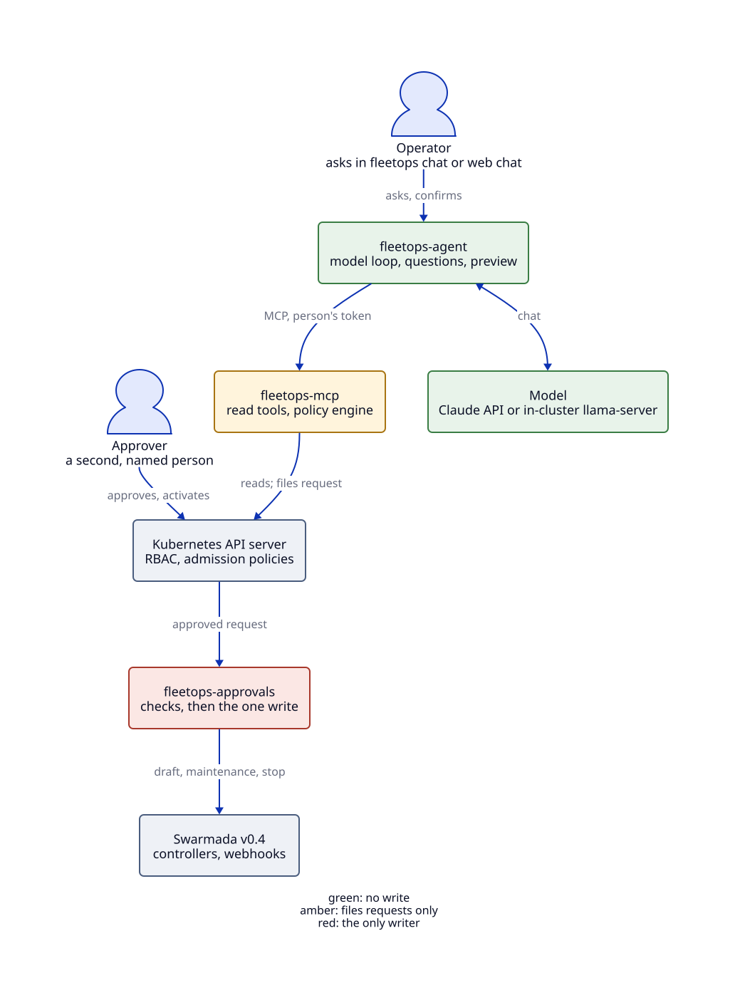
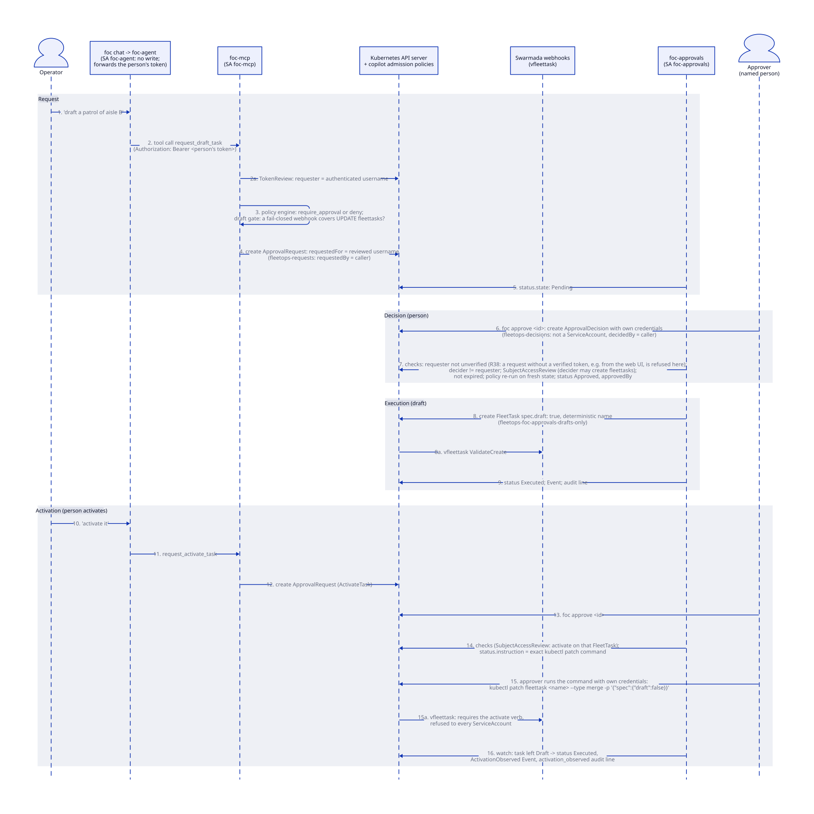

# Fleet Ops Copilot — Design

The main design elements. Each section links to the document that holds the detail; every
decision (D-number) has its full entry, with its reason, in [`design/decisions.md`](design/decisions.md).
What is not built, not measured or not enforced: [`KNOWN-LIMITS.md`](KNOWN-LIMITS.md).

## What it is

Fleet Ops Copilot is an operations assistant for a robot fleet orchestrated by
[Swarmada](https://github.com/swarmada/swarmada) v0.4 (public commit `558da47`, pinned in `go.mod`;
D1, D48). It answers operator questions about fleet state, proposes work, and turns proposed changes
into requests that a named person approves. It is a **client of Swarmada's public API**: it reads and
creates Swarmada resources through the Kubernetes API, and it changes no Swarmada CRD, proto,
controller, or file.

The customer in the examples, Example Distribution Co., is **fictional** (people, site and
namespace `warehouse-a` from Swarmada's quickstart). Its robot network has no route to the internet,
which gives the two model profiles below.

**Non-goals.**

- Not an emergency-stop path. Emergency stops are made with the site's physical E-stops or
  `swarmctl estop trigger` (`cmd/swarmctl/estop.go`). `request_zone_stop` waits for a person's
  approval and is therefore never the fastest way to stop a zone.
- No motion control, no adapter or proto interaction, no status writes.
- No Slack integration.

## Three processes

| Process | Does | Its ServiceAccount may | It may not |
|---|---|---|---|
| `fleetops-agent` | Model loop, guided dialogue (questions and preview), web chat; files a request only on the person's confirmation | `get`, `list` ApprovalRequests (requests panel, D51) | write anything; read Swarmada |
| `fleetops-mcp` | Read tools, `check_task`, request tools; verifies the caller's token (TokenReview), runs the policy engine | read Swarmada; create ApprovalRequests, Events, TokenReviews | write Swarmada; decide a request |
| `fleetops-approvals` | Checks each decision, re-checks, makes the one approved write, watches activations and outcomes | create held-draft FleetTasks and ZoneMaintenances; add the estop annotation to a FleetZone; dry-run FleetActions; write request status | delete, activate, clear a stop, edit running work |

People act with their own credentials: `fleetops chat` (the person's bearer token, D57),
`fleetops approve | reject` and `fleetops activate` (D6, D79). Details of each process, the
model backends, interfaces, packaging and repository layout:
[`design/components.md`](design/components.md). Tools and policy engine:
[`design/tools-and-policy.md`](design/tools-and-policy.md).

## Guarantees and where each is enforced

The agent never clears a stop, releases a robot, deletes, approves its own request, or edits
running work. Each guarantee holds in more than one place, so a wrong model answer, a bug in one
layer or a hand-made object does not break it.

| Guarantee | Policy engine (hard invariant) | RBAC | Copilot admission policy | Swarmada webhook |
|---|---|---|---|---|
| The model cannot write | the model is offered no request tool (D74) | fleetops-agent: no write (D51) | — | — |
| Only a confirmed preview is filed | `DENY_NOT_CONFIRMED`, `DENY_PREVIEW_MISMATCH` (D74) | — | `fleetops-requests`: requester = creator | — |
| Never approves its own request | requester ≠ approver; unverified requester never approved (D56) | only `fleetops:approver` (people) creates decisions | `fleetops-decisions`: a person, `decidedBy` = caller, immutable | — |
| Never clears a stop | `DENY_FORBIDDEN_OPERATION` | no `estop-clear` | `fleetops-approvals-zone-stop-only` | `estop-clear` checked per user |
| Never releases a robot | forbidden; `autoResumeAfterMinutes` must be 0 (D10) | no `delete`, `update`, `cancel` | — | — |
| Never deletes | forbidden | no `delete` on any kind | `fleetops-approvals-drafts-only` | — |
| Never edits running work | forbidden | no `update`/`patch` on FleetTask, FleetAction, Robot, ZoneMaintenance | drafts-only; `fleetops-approvals-dry-run-only` | — |
| Never activates | no tool (D28) | no `activate` | — | `activate` refused to every ServiceAccount |
| A draft holds work back | `DENY_DRAFT_GATE_ABSENT` when no fail-closed FleetTask webhook (D22) | — | — | FleetTask webhook served |
| Air-gapped: nothing leaves the cluster | — | — | — | NetworkPolicy, checked by `make verify-egress` (D50, D63) |

RBAC per ServiceAccount, the five admission policies and the NetworkPolicy rules:
[`design/rbac-and-admission.md`](design/rbac-and-admission.md). Each enforcement point has a
test (`TestRBACMatrix`, `TestFleetopsAgentCannotWrite`, `test/live`).

## Life of a request

1. **Ask.** A person asks for work in plain words; the model reads them into `propose_task`.
2. **Preview.** The dialogue engine, not the model, asks at most two numbered questions and shows a
   preview with `check_task`'s verdict and a "Checked:" block of what fleetops-agent read (D71–D73, D92).
3. **Confirm.** The person replies `1`; fleetops-agent files the stored request with the preview's
   id; fleetops-mcp verifies the token, re-checks the id and the policy, and creates an
   `ApprovalRequest` (D74, D57).
4. **Approve.** A different person runs `fleetops approve` with their own credentials; fleetops-approvals
   checks the decider (SubjectAccessReview), expiry and the policy on fresh state (D6, D7).
5. **Execute.** fleetops-approvals re-runs `check_task` and Swarmada dry runs, then makes one write:
   a held draft, a maintenance window or a zone stop (D25, D76).
6. **Activate.** A draft runs only once activated: its own request through steps 1–4, then a person
   Swarmada allows to activate runs `fleetops activate`; fleetops-approvals records who, then the
   outcome (D28, D78, D79).

Every step is written to a hash-chained audit file and as Events (D16). The full step list with
every check and refusal code: [`design/approvals.md`](design/approvals.md).

## Guided creation

A site catalogue (`catalogue/<site>.yaml`, D70) lists the kinds of work the site offers, what
Swarmada v0.4 can express and report for each, and the questions that lead to each. A pure engine
in fleetops-agent walks it: the model extracts fields, the engine asks the most discriminating
question first, infers what live state settles, shows defaults in the preview instead of asking, and
stops at two questions. "Something else" keeps the person's words verbatim and maps them to a known
kind, basic steps for review, or "not possible" (D72). Rules, catalogue schema, `check_task`,
conversation state and failure handling: [`design/guided-requests.md`](design/guided-requests.md).

## Two model profiles

| Profile | Model | Runs where | Egress |
|---|---|---|---|
| air-gapped (`make demo` default, D103) | Qwen2.5-7B-Instruct GGUF on llama-server (llama.cpp) | in the cluster | llama-server: none; the copilot's pods: cluster DNS and the API server, fleetops-agent also llama-server and fleetops-mcp (D50) |
| cloud | Claude via the Claude API, default `claude-sonnet-5-5`, `claude-opus-5-5` as a comparison (D29) | copilot in the cluster, model hosted by Anthropic | HTTPS to the Claude API only |

Same agent, tools, policy and approval path; only the backend differs (D14). How they are measured
(pass, failure classes, latency, cost, containment): [`design/evaluation.md`](design/evaluation.md).

## Section numbers used elsewhere

Code, tests and committed results cite this design by section number. The numbers are kept as
headings in the documents that now hold the text:

| § | Now in |
|---|---|
| §1, §1.2 | this document ("What it is") |
| §1.1, §2, §3, §3.5, §3.8, §3.9, §5, §6 | [`design/components.md`](design/components.md) (§1.1 and §2 summarised here) |
| §3.1, §3.2 | [`design/tools-and-policy.md`](design/tools-and-policy.md) |
| §3.3, §3.4 | [`design/approvals.md`](design/approvals.md) |
| §3.6, §3.7 | [`design/rbac-and-admission.md`](design/rbac-and-admission.md) |
| §3.10 to §3.10.9 | [`design/guided-requests.md`](design/guided-requests.md) |
| §4 to §4.4 | [`design/evaluation.md`](design/evaluation.md) |
| §7 (decision log), §8 (resolved questions) | [`design/decisions.md`](design/decisions.md) |

## Decisions

One line each; the full entry and its reason are in [`design/decisions.md`](design/decisions.md).
D3, D23, D24, D37, D41 and D55 were never assigned.

- [D1](design/decisions.md#d1) Target Swarmada v0.4 (RFC-0001 v0.4 + RFC-0003), commit `558da47`
- [D2](design/decisions.md#d2) Resolve Swarmada through the `go.mod` pin; no `go.work`
- [D4](design/decisions.md#d4) Every write tool creates an ApprovalRequest only
- [D5](design/decisions.md#d5) Three processes, three ServiceAccounts
- [D6](design/decisions.md#d6) A decision is an ApprovalDecision made with the approver's own credentials
- [D7](design/decisions.md#d7) Authority checked with SubjectAccessReview against the Swarmada verb
- [D8](design/decisions.md#d8) The executor writes as its own ServiceAccount, never by impersonation
- [D9](design/decisions.md#d9) Zone stop by annotation patch, held to one key by an admission policy
- [D10](design/decisions.md#d10) `autoResumeAfterMinutes` must be 0
- [D11](design/decisions.md#d11) Policy engine in Go with YAML rules, not OPA/Rego
- [D12](design/decisions.md#d12) Hard invariants compiled in
- [D13](design/decisions.md#d13) Official Go MCP SDK
- [D14](design/decisions.md#d14) One manual tool loop for both backends
- [D15](design/decisions.md#d15) llama-server's HTTP API through `net/http`
- [D16](design/decisions.md#d16) Audit: JSONL hash chain and Kubernetes Events
- [D17](design/decisions.md#d17) Deterministic harness, no model judge
- [D18](design/decisions.md#d18) CI gate on the scripted backend; model evals on demand
- [D19](design/decisions.md#d19) Fixtures in envtest with Swarmada's CRDs
- [D20](design/decisions.md#d20) Web UI as embedded static files
- [D21](design/decisions.md#d21) API group `fleetops.alexbahel.github.io`
- [D22](design/decisions.md#d22) Drafts fail closed without Swarmada's FleetTask webhook
- [D25](design/decisions.md#d25) Held drafts, created by the executor after approval
- [D26](design/decisions.md#d26) CI runs `make ci` on every push, beside a hygiene job
- [D27](design/decisions.md#d27) envtest finds Swarmada's CRDs through `go list -m`
- [D28](design/decisions.md#d28) The copilot never activates a draft
- [D29](design/decisions.md#d29) Cloud default `claude-sonnet-5-5`; `claude-opus-5-5` as a comparison
- [D30](design/decisions.md#d30) Model eval settings: effort medium, adaptive thinking, caching, no fallback
- [D31](design/decisions.md#d31) Fixtures also captured from live quickstart runs
- [D32](design/decisions.md#d32) Approval path proven against live Swarmada with webhooks served
- [D33](design/decisions.md#d33) A zone stop is attributed by Swarmada's safety audit log
- [D34](design/decisions.md#d34) Judge: a same-view `list_*` meets a required `get_*`
- [D35](design/decisions.md#d35) Judge: names from the prompt or the requested draft are not invented
- [D36](design/decisions.md#d36) dispatch-01 and dispatch-04 name the draft in the prompt
- [D38](design/decisions.md#d38) An expected policy code only when a request was attempted
- [D39](design/decisions.md#d39) Refusals judged by behaviour
- [D40](design/decisions.md#d40) A scenario pinning no fact still needs one cited real fact
- [D42](design/decisions.md#d42) A zone read is required only where the answer depends on it
- [D43](design/decisions.md#d43) `results.json` records every sampling field sent
- [D44](design/decisions.md#d44) Live scripts share one `fleetops-*` cluster guard
- [D45](design/decisions.md#d45) zone-05 is a no-action scenario
- [D46](design/decisions.md#d46) System prompt v2 sentences
- [D47](design/decisions.md#d47) The harness reset clears every kind a run can hold
- [D48](design/decisions.md#d48) `go.mod` pins Swarmada at `558da47`; CI Go job enabled
- [D49](design/decisions.md#d49) Qwen2.5-7B's published sampling settings for air-gapped runs
- [D50](design/decisions.md#d50) Air-gapped NetworkPolicy: llama-server has no egress
- [D51](design/decisions.md#d51) fleetops-agent may `get`, `list` ApprovalRequests
- [D52](design/decisions.md#d52) The web UI never approves or rejects
- [D53](design/decisions.md#d53) The write a request leads to is shown from the executor's builders
- [D54](design/decisions.md#d54) Tracing: one trace per request, no text in spans
- [D56](design/decisions.md#d56) No web login; unverified requests are never approvable
- [D57](design/decisions.md#d57) fleetops-mcp verifies the caller's bearer token (TokenReview)
- [D58](design/decisions.md#d58) CI regression gate held by `evals/baseline.json`
- [D59](design/decisions.md#d59) `make demo`: an empty machine to a running stack in one command
- [D60](design/decisions.md#d60) Person tokens on kind, test only
- [D61](design/decisions.md#d61) Optional tracing backend in the chart
- [D62](design/decisions.md#d62) CI warning when the baseline is lowered
- [D63](design/decisions.md#d63) The egress probe's four steps
- [D64](design/decisions.md#d64) llama-server's settings read and recorded in results
- [D65](design/decisions.md#d65) `fleetops-eval -otlp-endpoint` traces eval runs
- [D66](design/decisions.md#d66) Eval surface v3 (history; current surface D101)
- [D67](design/decisions.md#d67) Unsafe-write containment metric
- [D68](design/decisions.md#d68) Trace Collector egress to Jaeger only
- [D69](design/decisions.md#d69) fleetops-mcp and fleetops-agent egress to the Collector
- [D70](design/decisions.md#d70) Versioned site catalogue
- [D71](design/decisions.md#d71) A pure dialogue engine walks the catalogue
- [D72](design/decisions.md#d72) "Something else"; a finding is an inspection
- [D73](design/decisions.md#d73) `check_task`: likely feasible or blocked, from reads only
- [D74](design/decisions.md#d74) Only a confirmed preview is filed
- [D75](design/decisions.md#d75) Conversation state in fleetops-agent's memory
- [D76](design/decisions.md#d76) Execution re-check and dry runs of a draft
- [D77](design/decisions.md#d77) ApprovalRequest additions (v1alpha1, additive)
- [D78](design/decisions.md#d78) Failure handling and follow-up proposals
- [D79](design/decisions.md#d79) `fleetops activate` with the person's own credentials
- [D80](design/decisions.md#d80) SwarmadaConfig read in code only, projected
- [D81](design/decisions.md#d81) Eval surface v4: multi-turn scenarios, judge criterion 5
- [D82](design/decisions.md#d82) `make demo` preflight checks the quickstart's Python
- [D83](design/decisions.md#d83) Image binaries run as a non-root user
- [D84](design/decisions.md#d84) The reply shows every model response, then the engine's text
- [D85](design/decisions.md#d85) `propose_task`'s schema narrowed to the catalogue
- [D86](design/decisions.md#d86) `WAYPOINT_NOT_FOUND`; `FILING_ERROR`
- [D87](design/decisions.md#d87) The two-question cap counts every question shown
- [D88](design/decisions.md#d88) Field values checked for their form before `check_task`
- [D89](design/decisions.md#d89) Judge v5
- [D90](design/decisions.md#d90) Eval surface v5 (history; current surface D101)
- [D91](design/decisions.md#d91) A maintenance start of `now` means on approval
- [D92](design/decisions.md#d92) The "Checked:" block: what fleetops-agent read itself
- [D93](design/decisions.md#d93) Closed values limited to what the site policy allows
- [D94](design/decisions.md#d94) A field the kind does not use is refused
- [D95](design/decisions.md#d95) Judge v6
- [D96](design/decisions.md#d96) Each regression scenario triggers its own path
- [D97](design/decisions.md#d97) Eval surface v6, the surface of record
- [D98](design/decisions.md#d98) D94's refusal bounded per message
- [D99](design/decisions.md#d99) Judge v7: policy refusal wording
- [D100](design/decisions.md#d100) dispatch-07 requires no tool
- [D101](design/decisions.md#d101) Eval surface v7, current
- [D102](design/decisions.md#d102) `make ci` changes no tracked file
- [D103](design/decisions.md#d103) `make demo` is air-gapped by default
