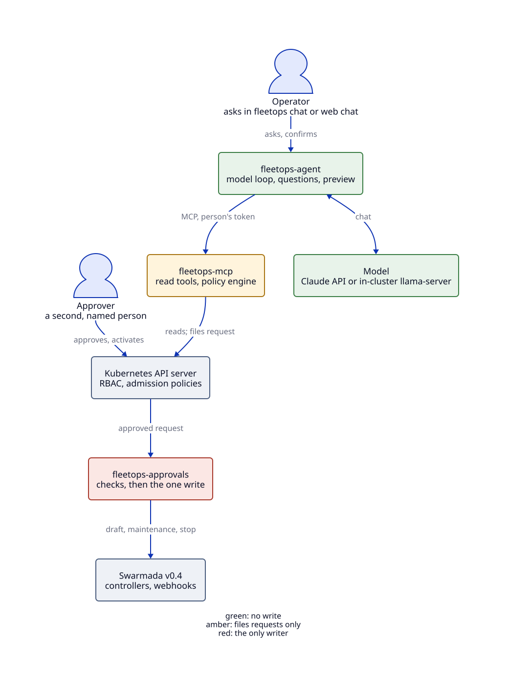

# Fleet Ops Copilot — Components

The processes, the model backends, the interfaces, packaging and the repository layout, with
the Swarmada version targeted and the fictional customer scenario. The summary is in
[`DESIGN.md`](../DESIGN.md).

## 1.1 Swarmada version targeted

| Item | Value |
|---|---|
| Module | `github.com/swarmada/swarmada` (Apache-2.0) |
| Spec version | RFC-0001 `swarmada-version: v0.4`, with RFC-0003 (semantic events and task triggers) |
| Source tree | commit `558da47fdb44d65d720ce9cd6791e97f19d1eab1`, tag `rfc-0001-v0.4`, pinned in `go.mod` as `v0.0.0-20261104205854-558da47fdb44` |
| API group/version | `swarmada.io/v1` (`api/v1`) |

`go.mod` pins the public commit; no `go.work` is used or committed (decisions D2, D48). Every API fact below is cited to a
path in the Swarmada module; RFC sections are cited by anchor (for example
`#security-permission-matrix`).

## 2. Fictional customer scenario

> **The customer below is fictional.** The name, site, and people are invented for this
> project. Any resemblance to a real organisation is unintended.

**Example Distribution Co. (fictional)** runs a third-party-logistics warehouse with a mixed
fleet of autonomous mobile robots managed by Swarmada in namespace `warehouse-a` (the namespace
used by the Swarmada quickstart, `config/samples/demo_a.yaml`).

- **Users.** Shift supervisors ask questions in plain language ("why is sim-robot-002 not taking
  work?", "put aisle B into maintenance after this wave"). A fleet-operations engineer approves
  changes. The site's platform team holds `swarmada:admin` and is the only group that can clear
  an emergency stop (RFC-0001 `#security-permission-matrix`).
- **Air-gapped constraint.** The robot network and its Kubernetes cluster have no route to the
  internet. A copilot used there must run its language model in the cluster, with egress blocked
  by NetworkPolicy. The same company's offsite operations centre has no such restriction and can
  use a hosted model.

This gives two deployments of the same agent:

| Deployment | Model | Runs where | Egress |
|---|---|---|---|
| `cloud` | Claude via the Claude API (default `claude-sonnet-5-5`, set by `FLEETOPS_CLAUDE_MODEL`; `claude-opus-5-5` measured as a comparison, D29) | copilot pods in the cluster, model hosted by Anthropic | HTTPS to the Claude API only |
| `airgap` | Qwen2.5-7B-Instruct, GGUF, served by `llama-server` (llama.cpp) | in-cluster Deployment | denied except the Kubernetes API and cluster DNS for the copilot components, and none for the model server, once the policy is in force for the pod; on kindnet a new pod's egress was open for up to ~1.3 s after its container started (D63) |

## 3. Architecture



Three processes with three ServiceAccounts. The process that talks to the model
(`fleetops-agent`) holds no Kubernetes write permission. The process that exposes tools to the model
(`fleetops-mcp`) can read Swarmada and create `ApprovalRequest` objects; it never writes to Swarmada
and cannot record a decision. `fleetops-approvals` writes to Swarmada only for a request a named person
approved: it creates drafts, zone maintenance windows and zone stops. Activating a draft is done
with the approver's own credentials, because Swarmada refuses it to every ServiceAccount ([§3.3](approvals.md#33-approval-flow)).

## 3.5 Agents

One orchestrator in `fleetops-agent` with five roles. Each role has its own system prompt and an
allow-list of MCP tools; the policy engine applies regardless of role. Not built: one tool-use loop
(`internal/agent`) offers every read tool, `check_task` and `propose_task` (`docs/KNOWN-LIMITS.md`).

| Role | Purpose | Tools |
|---|---|---|
| Router | Classifies the operator's request and hands it to one role | none |
| Diagnose | Explains robot, task, zone state from API fields and Events | read tools |
| Dispatch | Turns an ask into a previewed draft `FleetTask` or activation request ([§3.10](guided-requests.md#310-guided-task-requests-d70d81)) | read tools, `check_task`, `propose_task` (handled by fleetops-agent); the request is filed by fleetops-agent on the person's confirmation |
| Zone ops | Maintenance windows and zone stops, previewed like any request ([§3.10](guided-requests.md#310-guided-task-requests-d70d81)) | read tools, `check_task`, `propose_task`; filed by fleetops-agent on confirmation |
| Reporter | Writes the final answer; every claim cites a resource and field | read tools, `get_request` |

**LLM backends** behind one Go interface (`Chat(ctx, messages, tools) → reply`):

- `claude`: Anthropic Go SDK (`github.com/anthropics/anthropic-sdk-go/v2`), Messages API,
  manual tool-use loop (the same loop runs both backends, so policy checks and tracing sit in
  one place). Model from `FLEETOPS_CLAUDE_MODEL` (default `claude-sonnet-5-5`), effort set explicitly
  (`medium` for both measured models, D30). Adaptive thinking; each assistant turn is sent back
  as returned, thinking blocks included. Tools and system prompt are prompt-cached. No
  server-side refusal fallback: a refusal is recorded as such, so a measurement always names the
  model that answered (D30). Built: `internal/llm/claude.go`.
- `llamacpp`: `llama-server`'s HTTP chat-completions endpoint with tool calling, called with
  `net/http` (no extra SDK). Model file Qwen2.5-7B-Instruct GGUF; quantisation set in
  `config/airgap/llama-server.yaml` and recorded in every measurement. Built: `internal/llm/llamacpp.go`; `fleetops-eval -backend
  llamacpp`; manifests in `config/airgap/`; the chart's `llm.profile: airgap` (D103).
- `scripted`: replays fixed model turns; used by unit tests and the CI eval gate.

## 3.8 Observability and secrets

- OpenTelemetry traces (D54): one trace per operator request, with a root span in `fleetops-agent`, a
  span per model call (token counts and latency), a span per tool call on each side of MCP (the
  trace context crosses in `_meta` as W3C `traceparent`), and a span per policy decision in
  `fleetops-mcp`. No span carries prompt, answer, tool argument or tool result text, and a redacting
  exporter masks secrets before export. OTLP/gRPC exporter (`-otlp-endpoint` or
  `OTEL_EXPORTER_OTLP_ENDPOINT`); unset means tracing is off. Approval and execution spans in
  `fleetops-approvals` are not built.
- Secrets (`ANTHROPIC_API_KEY`, tokens) come only from environment variables populated from
  Kubernetes Secrets. A redaction step removes the values of every configured secret and known
  token patterns from span attributes, logs, audit lines, and Events. No copilot process
  receives an approver's credential. `fleetops-agent` and `fleetops-mcp` receive the requester's own bearer
  token for a chat that carries one; `fleetops-mcp` uses it only in a `TokenReview` and keeps only its
  SHA-256 for 30 seconds as a cache key (D57).

## 3.9 Interfaces

- `fleetops` CLI: `fleetops chat` (sends the person's own bearer token to `fleetops-agent`, D57; keeps the
  conversation id between invocations, D75), `fleetops requests`, `fleetops approve|reject <id>`,
  `fleetops activate <id>` (runs an approved activation with the person's own kubeconfig, D79),
  `fleetops audit verify`.
- Web chat UI served by `fleetops-agent` (Go `net/http`, embedded static HTML/JS, no front-end build
  step), with a requests panel showing each `ApprovalRequest`, its policy decision, the exact
  write it leads to and the commands to decide it; it never decides (D52, D53, D56). Each chat
  message is one agent run; a conversation id carries bounded history and the dialogue state
  across messages (D75).

## 5. Packaging

- `Dockerfile`: one runtime image for fleetops-mcp, fleetops-approvals and fleetops-agent, from
  binaries built on the host (D2).
  Plain manifests in `config/` (`crd`, `rbac`, `admission`, `deploy`); `make chart-parity` checks
  that the Helm chart renders the same objects.
- Helm chart `charts/fleet-ops-copilot` (`values.yaml`, `llm.profile: cloud` by default;
  `llm.profile: airgap` runs fleetops-agent with the `llamacpp` backend, D103); llama-server, its model
  storage and the egress policies are installed beside it from `config/airgap/` (`hack/airgap.mk`).
- `make demo` (`hack/demo-up.sh`, D59): creates the `kind` cluster `fleetops-demo` (name settable, always
  `fleetops-*`) with the test-only person tokens (D60), runs the Swarmada quickstart from the pinned
  module, turns its admission webhooks on, keeps the simulated fleet live
  (`hack/demo-sim-fleet.sh`: one sim adapter per robot in the background, RobotClass
  `simbot-v1` as a labelled demo workaround), installs the chart, checks health and prints the
  elapsed time. Air-gapped by default, cloud with `DEMO_MODEL=cloud` (D103). `make demo-down` removes that one cluster, its kubeconfig and the tokens; it never
  deletes a cluster it did not name.
- `docs/RUNBOOK.md`: install, configure, approve, rotate secrets, read the audit, recover.
- `docs/KNOWN-LIMITS.md`: everything not measured or not enforced, including the items in [§1.2](../DESIGN.md#what-it-is),
  [§3.2](tools-and-policy.md#32-policy-engine-go-yaml-policy-files) (draft gate), [§3.6](rbac-and-admission.md#36-kubernetes-rbac-and-admission-policies) and [§3.7](rbac-and-admission.md#37-networkpolicy).

## 6. Repository layout

```text
cmd/fleetops            CLI
cmd/fleetops-mcp        MCP server
cmd/fleetops-agent      agent process + web UI
cmd/fleetops-approvals  approval controller + executor
test/envtest       API-server tests: RBAC, admission policies, approval path
api/v1alpha1       ApprovalRequest, ApprovalDecision (fleetops.alexbahel.github.io)
internal/tools     typed read and request tools
internal/policy    policy engine + YAML loader
internal/approval  store, decision checks, executor
internal/audit     JSONL writer, Events, verify
internal/llm       backend interface; claude, llamacpp and scripted backends
internal/agent     tool-use loop over MCP
internal/testenv   shared envtest environment for tests and evals
internal/mcpserver the copilot's tools exposed over MCP (fleetops-mcp)
internal/fleet     Kubernetes scheme and the cluster reads shared by the processes
internal/draft     the held-draft FleetTask a request leads to
internal/redact    secret redaction
internal/authn     requester authentication (TokenReview of the caller's bearer token)
internal/tracing   OpenTelemetry setup, redacting exporter, trace context over MCP _meta
internal/webui     fleetops-agent's web chat and requests panel
internal/requestview  an ApprovalRequest shown with the exact write it leads to
internal/catalogue    site catalogue loader and validation (D70)
internal/dialogue     catalogue-driven question/preview engine (D71, D72)
internal/feasibility  check_task's evaluation, shared by fleetops-mcp, fleetops-approvals and fleetops activate (D73)
internal/conversation fleetops-agent's bounded, per-owner conversation store (D75)
catalogue/         site catalogues (the fictional warehouse's)
evals/             harness, scenarios, fixtures, results
charts/            Helm chart
config/            CRDs, RBAC, ValidatingAdmissionPolicy manifests, Deployments (deploy/), air-gapped profile (airgap/)
policies/          default policy files
```
